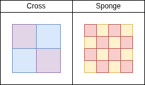

# Cross Sponge

CrossSponge è un crittosistema scalabile in quanto lo stato interno può avere diverse dimensione a patto che si rspetti una dimensione di elementi pari al quadrato di un numero pari.Si basa sulle sponge function, per garantire un'elevata diffusione e non-linearità dei dati ad ogni round.

Si componse di due fasi:
- warm-up: cross + ...
- assorbimento ...

