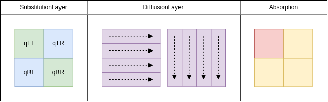

# Cross Sponge

Cross Sponge è un crittosistema scalabile in quanto lo stato interno può avere diverse dimensione a patto che si rspetti una dimensione di elementi pari al quadrato di un numero pari.Si basa sulle sponge function, per garantire un'elevata diffusione e non-linearità dei dati ad ogni round.

## Fasi 
Si componse di due fasi:
- warm-up: cross + ...
- assorbimento ...

## Permutazioni

#### Layer di Sostituzione Non Lineare (SubstitutionLayer)

Il SubstitutionLayer rappresenta la S-Box non lineare del cifrario. Divide lo stato $N \times N$ in 4 quadranti ($q_{TL}, q_{TR}, q_{BL}, q_{BR}$) e applica una trasformazione algebrica in $\mathbb{F}_2$. 
- $q_{TL} \leftarrow q_{TL} \oplus q_{TL} \cdot q_{BR} + a_C$
- $q_{TR} \leftarrow q_{TR} \oplus q_{TR} \cdot q_{BL} + a_C$
- $q_{BL} \leftarrow q_{BL} \oplus q_{BL} \cdot q_{TR} + a_C$
- $q_{BR} \leftarrow q_{BR} \oplus q_{BR} \cdot q_{TL} +a_C$

### Layer di Diffusione Lineare (DiffiusionLayer)
Il DiffiusionLayer garantisce la diffusione orizzontale e verticlae delle informazioni all'interno dello stato. Applica una traslazione circolare a destra di passo $N/2$ a ciascuna riga e ciascuna colonna della matrice dello stato.Assicura che i bit di differenti quadranti si mescolino tra loro nei round successivi.

- **righe**: $r_i <<< i$
- **colonne**: $c_i <<< i$

